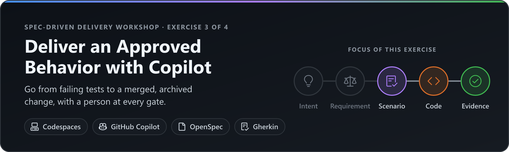
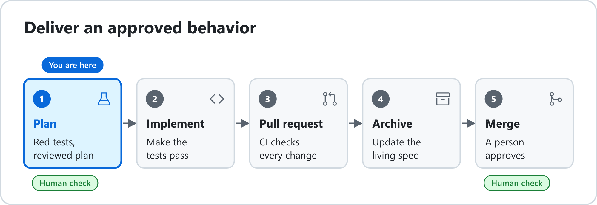
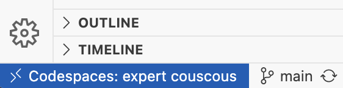
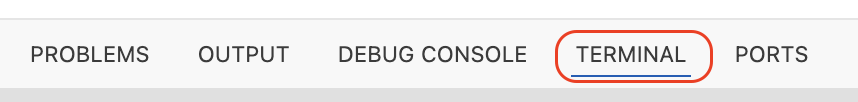
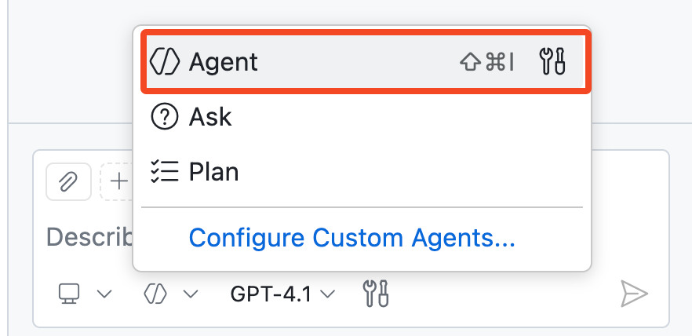
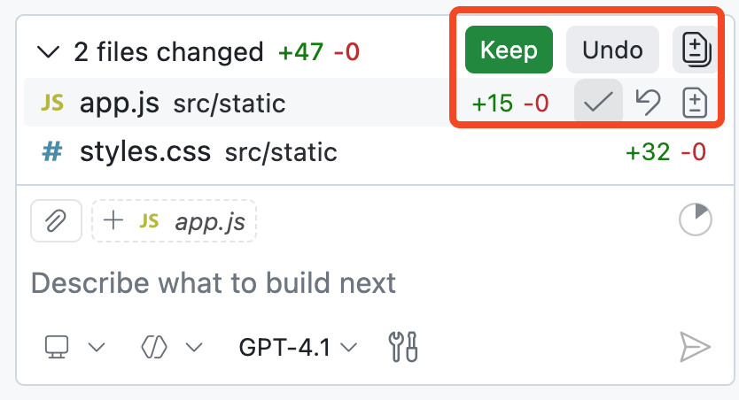

## Step 1: Plan the delivery and write failing tests



Welcome back to the Contoso Health Plan delivery team, @{{ login }}! :wave: Subscribers on a family plan can see the claims of their dependents in the member portal, but some claims must stay private. The product owner and the privacy lead approved the change `implement-dependent-privacy`, and today your team delivers it with Copilot. Before anyone writes code, you need to know which test will prove each approved scenario.

### 📖 Theory: Test-first delivery with a human gate

**Test-first** delivery starts from approved scenarios, not from code. A **delivery plan** maps each scenario ID to the code that will change and the test that will prove it, and a person reviews that plan against the spec before coding starts: AI drafts, humans decide. The new tests must fail against the unfinished code. This failing state is called **red**, and it shows that the tests really call the code. In [Agent mode](https://code.visualstudio.com/docs/copilot/chat/chat-agent-mode), Copilot Chat can create and edit files and run commands, so every prompt states what Copilot may change and what it must leave alone.



| What | Where it lives in this repository |
| --- | --- |
| Approved change: proposal, design, tasks | `openspec/changes/implement-dependent-privacy/` |
| Requirements and scenarios (`001-US3-AS1` to `001-US3-AS6`) | `openspec/changes/implement-dependent-privacy/specs/member-claim-privacy/spec.md` |
| Acceptance examples, tagged with scenario IDs | `features/claim-privacy.feature` |
| The rule to implement, a stub for now | `src/claim-visibility.js` |
| Supplied list and lookup code that calls the rule | `src/claim-status.js` |

### ⌨️ Activity 1: Open your codespace and create a branch

Your copy of this repository comes with a ready-made [codespace](https://docs.github.com/en/codespaces/overview): an online editor with Node.js, Cucumber.js, the OpenSpec command-line tool and Copilot Chat already set up.

1. Right-click the button below and open it in a new tab, so you can keep these instructions open.

   [](https://codespaces.new/{{ full_repo_name }}?quickstart=1)

1. On the codespace page, check that the repository is `{{ full_repo_name }}`, your copy, and not the original exercise. Then select **Create new codespace**. If you already have a codespace for this repository, the page offers **Resume this codespace** instead; that works too.

1. Wait for the editor to open. The first start takes about 2 to 4 minutes, because the codespace installs everything this exercise needs before it opens. The approved proposal opens automatically.

   > ⏳ **Wait:** You are ready when the bottom-left corner of the editor shows **Codespaces** followed by your codespace's name.

   

1. Open a terminal with `` Ctrl+` `` (`` ⌃` `` on Mac), or from the menu (☰) at the top left with **Terminal** > **New Terminal**. Then create the branch for this delivery.

   > 
   >
   > ```bash
   > git switch -c implement-dependent-privacy
   > ```

<details>
<summary>Having trouble? 🤷</summary><br/>

- **No terminal is visible:** In the panel at the bottom of the editor, select the **TERMINAL** tab. If there is no panel, press `` Ctrl+` `` (`` ⌃` `` on Mac), or use **Terminal** > **New Terminal**.

  

- **The codespace opened the original exercise:** Close that tab and use the button above, which points to your copy. You can also start one from your repository page: **Code** > **Codespaces** > **Create codespace on main**.

- **A command says a package is missing:** The setup did not finish. Run `npm ci` in the terminal, then try again.

- **Copilot Chat asks you to sign in:** Select the Copilot icon in the Status Bar at the bottom of the editor, then sign in with your GitHub account.

</details>

### ⌨️ Activity 2: Ask Copilot for a plan, then review it

Copilot drafts the plan; you decide whether it is good enough to build from. The plan must cover every scenario in `openspec/changes/implement-dependent-privacy/specs/member-claim-privacy/spec.md`, where each `#### Scenario:` line carries one ID, from `001-US3-AS1` to `001-US3-AS6`. To open a file by name, press `Ctrl+P` (`Cmd+P` on Mac) and type part of its name.

1. Open Copilot Chat: select the chat icon at the top of the editor, or press `Ctrl+Alt+I` (`⌃⌘I` on Mac). Set the mode to **Agent** in the chat box.

   

   Then ask Copilot for a plan. The last sentences of the prompt keep it away from the code.

   > 
   >
   > ```prompt
   > Read the approved change in openspec/changes/implement-dependent-privacy
   > (proposal.md, design.md, tasks.md and specs/member-claim-privacy/spec.md),
   > features/claim-privacy.feature and src/claim-status.js.
   > Create delivery/plan.md with a table that has one row per "#### Scenario:" ID
   > in the spec and these columns:
   > Scenario ID | Requirement | Code to change | Unit test name | Gherkin scenario
   > Start each unit test name with its scenario ID, for example "001-US3-AS1: ...".
   > Write "none" when no Gherkin scenario is tagged with that ID.
   > Below the table, list any conflicts or open questions.
   > Do not write code. Do not edit any other file.
   > ```

   > 💡 **Tip:** Copilot's output varies from run to run, so your plan will not match a neighbor's. That's fine: Mona checks files, tests and CI, never Copilot's wording.

1. Copilot lists the files it changed above the chat box. Select **Keep** to accept `delivery/plan.md`.

   

   Then open `delivery/plan.md` next to the spec and review it as the human gate:

   - There is one row for each of the six scenario IDs, and no invented IDs.
   - Each row names the right requirement: `001-US3-AS1` to `AS3` belong to `001-FR-011`, `AS4` and `AS5` to `001-FR-012`, and `AS6` to `001-FR-013`.
   - **Code to change** names only `src/claim-visibility.js`. The design says no other source file changes.
   - The Gherkin column says `none` for `001-US3-AS1` and `001-US3-AS2`. Only a unit test will prove those two.
   - Nothing in the plan changes the spec, the feature or the step definitions.

1. Fix any row that fails the review, yourself or by asking Copilot. Then add this section at the end of `delivery/plan.md`, with your own role, and save the file.

   ```markdown
   ## Human review

   Reviewed by: <your role, for example Tester>
   Decision: Approved for test-first implementation
   Checked: one row per scenario ID; only src/claim-visibility.js changes; no spec or feature edits
   ```

<details>
<summary>Having trouble? 🤷</summary><br/>

- **There is no Agent mode in the chat box:** Make sure you are signed in to Copilot, then look for the mode picker in the chat box. If your organization turned Agent mode off, create `delivery/plan.md` yourself and use Ask mode to draft rows that you paste in.

- **Copilot stops answering or says you've reached a limit:** Steps 1 and 2 need Copilot's Agent mode. In a workshop, pair with a neighbor whose Copilot still answers. On your own, continue when your monthly allowance resets.

- **Copilot edited another file:** Undo it with `git restore <file>` in the terminal, then ask again. Run `git status` to see what changed.

- **Copilot listed a conflict or an open question:** Good. Read it against the spec. If the spec answers it, note the answer in the plan. If it doesn't, a real team would ask the product owner before coding.

</details>

### ⌨️ Activity 3: Add failing tests and push them

1. In the same chat, ask Copilot to write the tests from the plan.

   > 
   >
   > ```prompt
   > Following delivery/plan.md, create tests/claim-visibility.test.js using node:test
   > and node:assert/strict. Write one test per scenario ID and start each test name
   > with the ID, for example test('001-US3-AS1: ...').
   > Test canViewDependentClaim from src/claim-visibility.js, and listDependentClaims
   > and findDependentClaim from src/claim-status.js. Use only fictional SYN- claim IDs.
   > Do not implement the code. Do not change src/, features/ or openspec/.
   > ```

1. Keep the new file and read the test names: each one starts with a scenario ID. Before you run anything, predict how many tests will fail. The stub throws `Not implemented` every time it is called. Then run the unit tests.

   > 
   >
   > ```bash
   > npm run test:unit
   > ```

1. Scroll up to the summary lines that start with `ℹ`, just above the `✖ failing tests:` list. `ℹ fail` is at least 6, and each of the six scenario tests shows `Error: Not implemented`. That is red. Then run the acceptance examples, which fail for the same reason: `4 scenarios (4 failed)`.

   > 
   >
   > ```bash
   > npm run test:bdd
   > ```

   > 💡 **Tip:** A scenario test that passes now never reaches the rule, so it cannot prove it. Ask Copilot why it passes, and fix it before you continue. An extra test for behavior that already works, such as rejecting a caller who is not signed in, may pass.

1. Commit the plan and the tests, and push your branch.

   > 
   >
   > ```bash
   > git add delivery/plan.md tests/
   > git commit -m "Plan 001-US3 delivery and add failing tests"
   > git push -u origin implement-dependent-privacy
   > ```

   Git prints a link to create a pull request. Don't open one yet; you'll do that in step 3.

1. Go back to this issue in your browser. Wait a moment for Mona to check your work, provide feedback, and share the next lesson.

<details>
<summary>Having trouble? 🤷</summary><br/>

- **`npm run test:unit` reports `tests 0`:** Node.js runs only files that match `tests/*.test.js`. Check the folder and the file name.

- **Copilot changed `src/claim-visibility.js`:** Undo it with `git restore src/claim-visibility.js`. The code comes in the next step, after the tests are red.

- **Mona says a scenario ID is missing:** The check log lists the missing IDs. Add a row to the plan or a test for each one, then commit and push again. Mona checks every push to `implement-dependent-privacy`.

- **Mona says the review line is missing:** Mona reads the last `Reviewed by:` line in the plan. In the section you added at the end, write your role after `Reviewed by:` on the same line, for example `Reviewed by: Business analyst`. Delete any `Reviewed by:` line Copilot added higher up, so the plan has one clear sign-off.

- **Mona did not respond:** Check that you pushed to `implement-dependent-privacy` and that `delivery/plan.md` or a file in `tests/` changed. You can watch the run in the [Actions tab](https://github.com/{{ full_repo_name }}/actions).

</details>
