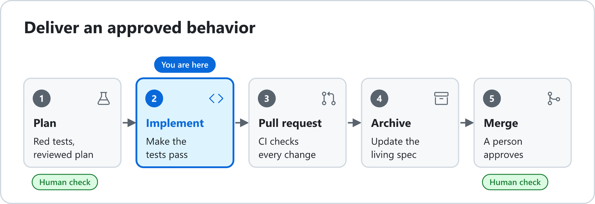

## Step 2: Implement with Copilot until the evidence is green

Your plan is reviewed and your tests are red, @{{ login }}. :red_circle: Now Copilot writes the code. The question for this step: can Copilot make the tests pass without changing what "pass" means?

### 📖 Theory: The target doesn't move

In [Agent mode](https://code.visualstudio.com/docs/copilot/chat/chat-agent-mode), Copilot plans the edits, changes files, runs commands such as tests, reads the results and tries again until it reaches the goal. In spec-driven delivery the approved spec, the feature file and your red tests are the target, so only the code may change. If Copilot edits a test, a scenario or the spec to get a pass, it has moved the target, and the green result proves nothing. This repository's [custom instructions](https://docs.github.com/en/copilot/how-tos/configure-custom-instructions/add-repository-instructions) in `.github/copilot-instructions.md` give Copilot the same rule, and your review of the diff is the check that it followed them. Copilot's output varies, so Mona grades files and test results, never Copilot's wording.



### ⌨️ Activity 1: Ask Copilot to implement the rule

1. In your codespace, open Copilot Chat in **Agent** mode. You can keep the chat from step 1 or start a new one.

1. Ask Copilot to implement the rule. The prompt names the goal, the one file it may change and the files it must not touch.

   > 
   >
   > ```prompt
   > Implement canViewDependentClaim in src/claim-visibility.js so that it follows
   > requirement 001-FR-011 in
   > openspec/changes/implement-dependent-privacy/specs/member-claim-privacy/spec.md.
   > Run npm test and keep going until the unit tests and the Gherkin feature pass.
   > Change only src/claim-visibility.js. Do not edit tests/, features/, openspec/
   > or src/claim-status.js. If a test seems wrong, stop and tell me instead of changing it.
   > ```

1. Copilot may ask for your permission before it runs a command in the terminal. Read the command first, and allow it only if it runs the tests, for example `npm test`.

1. When Copilot finishes, keep the changes it made.

   > 💡 **Tip:** If Copilot says a test is wrong, don't let it change the test. Compare the test with the scenario in the spec, and ask the product owner when the spec itself is unclear. If the test really is wrong, fix it yourself in its own commit, as the hint below shows. On a real team, that commit gets its own review.

<details>
<summary>Having trouble? 🤷</summary><br/>

- **Copilot keeps failing the same test:** Ask it to explain which line of requirement `001-FR-011` the failing test checks. A short reply often unblocks it. You can also start a new chat and send the prompt again.

- **A test really contradicts the spec:** Fix only that test yourself, keep its scenario ID in the name, and commit it on its own with a message that names the ID: `git add tests/` then `git commit -m "Fix the 001-US3-AS4 test to match the spec"`. Say so in your pull request description. Then ask Copilot to continue.

- **Copilot edited a file it shouldn't have:** Undo that file with `git restore --source main -- <file>`, for example `git restore --source main -- features/claim-privacy.feature`. For your own test file, which isn't on `main`, use `git restore tests/claim-visibility.test.js`. Then ask Copilot again, and repeat that the file must not change.

- **Copilot stops answering or says you've reached a limit:** This step needs Copilot's Agent mode. In a workshop, pair with a neighbor whose Copilot still answers. On your own, continue when your monthly allowance resets; your branch keeps your progress.

- **Copilot wrote a lot more code than one function:** That's a scope problem, not a style choice. Ask it to keep the change to `src/claim-visibility.js` only.

</details>

### ⌨️ Activity 2: Review the diff and push

Green tests are evidence, not proof. Before you push, you check what changed and whether the code says what the spec says.

1. In the terminal, list the files that changed since your last commit.

   > 
   >
   > ```bash
   > git status --short
   > ```

   You should see only ` M src/claim-visibility.js`. If anything in `tests/`, `features/` or `openspec/` appears, undo it as the hint above shows.

1. Open `src/claim-visibility.js` and read the new code next to requirement `001-FR-011`. Walk it through four ages, with no confidential request and a known sensitive flag:

   | Age | Routine claim | Sensitive claim |
   | --- | --- | --- |
   | 12 | visible | visible |
   | 13 | visible | hidden |
   | 17 | visible | hidden |
   | 18 | hidden | hidden |

   Also check that a missing or invalid age or flag hides the claim, so the rule fails closed.

1. Run the full test suite yourself. Both parts must pass: the unit summary shows `ℹ fail 0`, and Cucumber shows `4 scenarios (4 passed)`.

   > 
   >
   > ```bash
   > npm test
   > ```

1. Commit the implementation and push it.

   > 
   >
   > ```bash
   > git add src/claim-visibility.js
   > git commit -m "Implement 001-FR-011 dependent claim visibility"
   > git push
   > ```

1. Go back to this issue in your browser. Wait a moment for Mona to check your work, provide feedback, and share the next lesson.

<details>
<summary>Having trouble? 🤷</summary><br/>

- **Mona says the protected files changed:** Mona compares `features/`, `openspec/` and `src/claim-status.js` with `main`. Ticking boxes in `tasks.md` is fine. Restore the rest with `git restore --source main -- features openspec src/claim-status.js`, then commit and push.

- **Mona says the tests fail, but they pass in your codespace:** Make sure you committed every change. `git status --short` should print nothing after you commit. Then push again.

- **Mona says the scenario IDs are missing from the tests:** Your test names must still start with the six IDs from step 1. Run `git log --oneline -- tests/` to find your step 1 commit, restore the tests from it with `git restore --source <commit> -- tests/`, then commit and push.

- **Mona did not respond:** Mona checks pushes to `implement-dependent-privacy` that change `src/` or `tests/`. To check again without a new change, go to the [Actions tab](https://github.com/{{ full_repo_name }}/actions), select **Step 2**, then **Run workflow**, choose the `implement-dependent-privacy` branch and select **Run workflow**.

</details>
