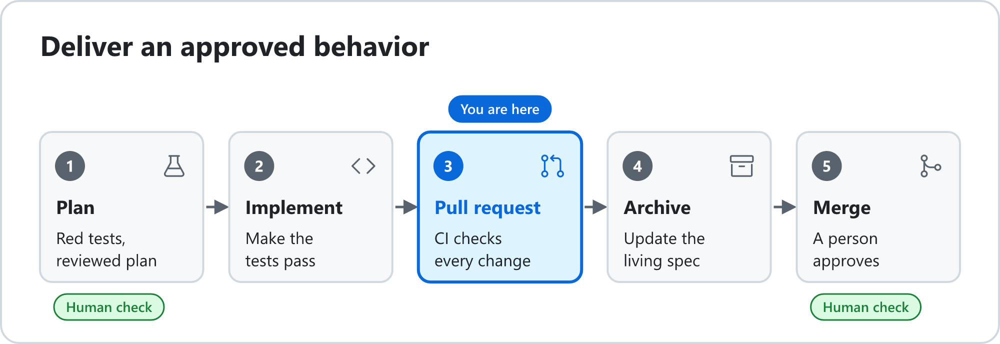
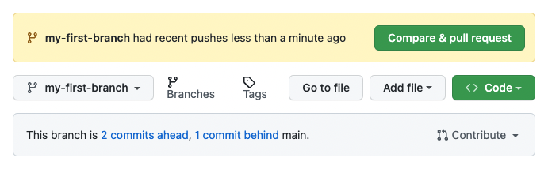

## Step 3: Open a pull request with evidence and pass CI

Your code is green in your codespace, @{{ login }}. :green_circle: But "it passes on my machine" is not evidence a reviewer can rely on. What does a reviewer need to trust this change? A pull request that traces every scenario ID to evidence, says what that evidence does not prove, and passes the same checks on a clean machine.

### 📖 Theory: CI checks every change

[Continuous integration (CI)](https://docs.github.com/en/actions/about-github-actions/about-continuous-integration-with-github-actions) runs the same checks on a clean machine every time a pull request changes. This repository's `CI` workflow, `.github/workflows/ci.yml`, installs the locked dependencies, runs the unit tests and the Gherkin feature, and validates every OpenSpec change and spec in strict mode. Its result appears on the pull request as a [status check](https://docs.github.com/en/pull-requests/collaborating-with-pull-requests/collaborating-on-repositories-with-code-quality-features/about-status-checks), so every reviewer sees the same evidence. Green CI still proves only what its checks assert, which is why the pull request says what the evidence does not prove, as you did in the first exercise of this workshop.



### ⌨️ Activity 1: Collect your evidence

1. In your codespace terminal, run every check that CI will run.

   > 
   >
   > ```bash
   > npm run check
   > ```

1. Note the three results you'll use as evidence: the OpenSpec totals line (`Totals: 2 passed, 0 failed (2 items)`), the unit test summary (`ℹ pass` and `ℹ fail`) and the Cucumber summary (`4 scenarios (4 passed)`).

1. From memory, before you look anything up, answer the question from the first exercise: what does this evidence **not** prove? Think about what the tests don't check, such as real member data, real screens, or how a claim gets marked sensitive.

<details>
<summary>Having trouble? 🤷</summary><br/>

- **`npm run check` fails:** Read the first error. If OpenSpec validation fails, a file under `openspec/` changed: restore it with `git restore --source main -- openspec`. If a test fails, go back to step 2.

- **You can't think of a limit:** Read the **Non-goals** in `openspec/changes/implement-dependent-privacy/proposal.md` and the **Risks** in `design.md`. Anything outside the rule's inputs, such as where the age or the sensitive flag comes from, is not proven by these tests.

</details>

### ⌨️ Activity 2: Open the pull request and watch CI

1. In your browser, go to your repository, `{{ full_repo_name }}`. Open the **Pull requests** tab and [create a pull request](https://docs.github.com/en/pull-requests/collaborating-with-pull-requests/proposing-changes-to-your-work-with-pull-requests/creating-a-pull-request) with `main` as the base branch and `implement-dependent-privacy` as the compare branch.

   > 💡 **Tip:** If a **Compare & pull request** banner appears for `implement-dependent-privacy`, you can use it instead.

   

1. Give it a short title, such as `Deliver dependent claim privacy`. In the description, write in your own words:

   - The requirement IDs and all six scenario IDs this change delivers, each written in full. A range such as `001-US3-AS1 to 001-US3-AS6` counts only its two ends.
   - The evidence: what you ran and the results you noted.
   - A section headed **What the evidence does not prove**, with at least one limit.

1. Create the pull request, but **don't merge it yet**. You'll add one more commit in the next step.

1. On the pull request's **Conversation** tab, scroll to the checks near the bottom. Wait for the **CI / Tests and spec validation** check to finish with a green check mark. Mona's own checks appear in the same list. If it fails, select **Details**, read the first error, fix it in your codespace, then commit and push.

1. Go back to the exercise issue. Wait a moment for Mona to check your work, provide feedback, and share the next lesson.

   > ⏳ **Wait:** Mona waits for CI to finish before grading, so this check can take a few minutes.

<details>
<summary>Having trouble? 🤷</summary><br/>

- **Mona says scenario IDs are missing from the description:** Edit the pull request description: select the three-dot menu at the top right of the description, then **Edit**. Add the missing IDs, each written in full, and select **Update comment**. Mona checks again on every edit.

- **Mona says the limits are missing:** Add a line or heading that contains the words `does not prove`, followed by at least one limit.

- **Here's an example description, if you are stuck:**

  ```markdown
  Delivers 001-FR-011, 001-FR-012 and 001-FR-013 (dependent claim privacy).

  | Scenario | Evidence |
  | --- | --- |
  | 001-US3-AS1, 001-US3-AS2 | Unit tests with the same IDs pass |
  | 001-US3-AS3, 001-US3-AS4, 001-US3-AS5, 001-US3-AS6 | Unit tests and Gherkin scenarios with the same IDs pass |

  Evidence: npm run check, OpenSpec validation passed, unit tests ℹ fail 0, 4 scenarios (4 passed). CI passed on this pull request.

  ## What the evidence does not prove

  - That ages and sensitive flags from real systems are correct; the tests use fictional inputs.
  - That any screen or message shows the result correctly.
  ```

- **Mona says CI did not pass:** On the pull request, select **Details** next to the **CI** check to read the log. Fix the first failure in your codespace, then commit and push. Mona checks again on every push.

- **CI is green, but Mona's CI row is ❌:** Mona waits up to 5 minutes for CI. Edit the pull request description, make any small change, and select **Update comment**. Mona checks again and finds the finished run.

- **You opened the pull request before Mona posted this step:** Edit its description, make any small change, and select **Update comment**. Mona checks it then.

- **Mona did not respond:** Check that the pull request targets `main` and comes from `implement-dependent-privacy`. You can watch the run in the [Actions tab](https://github.com/{{ full_repo_name }}/actions).

</details>
