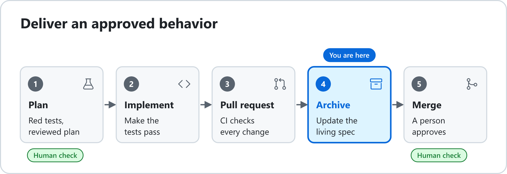

## Step 4: Archive the change into the living spec

CI is green on your pull request, @{{ login }}. :white_check_mark: The code now does what the approved change describes, but the rules still sit in a folder for changes in progress. Where do the new rules live once the change is delivered? In the living spec, and archiving puts them there.

### 📖 Theory: From active change to living spec

An **active change**, a folder under `openspec/changes/`, describes rules that are on their way. The **living spec** under `openspec/specs/` describes how the system behaves today, so the next team that reads it can trust it. [Archiving](https://github.com/Fission-AI/OpenSpec/blob/main/docs/cli.md#openspec-archive) merges the change's requirements into `openspec/specs/member-claim-privacy/spec.md` and moves the change folder to `openspec/changes/archive/YYYY-MM-DD-implement-dependent-privacy/`, a dated record of what was decided. The command shows what it will update and asks before it writes, and it warns you when tasks are still unticked. Both answers are human decisions, so you run it without `--yes`.




### ⌨️ Activity 1: Tick the tasks and archive the change

1. In your codespace, open `openspec/changes/implement-dependent-privacy/tasks.md`. For each task that really happened, change `- [ ]` to `- [x]`. By now that should be all six: the plan and its review, the red tests, the code, the green tests, the pull request and CI. Save the file.

   > 💡 **Tip:** Tick only what happened. If a task didn't happen, finish it first. A ticked box is a claim that someone can check.

1. Before you run the command, predict: which new folder will hold the rules after archiving?

1. In the terminal, archive the change. Leave out `--yes`, so you can read each question before you answer it.

   > 
   >
   > ```bash
   > npx openspec archive implement-dependent-privacy
   > ```

1. Read the summary before you answer. It should show `Task status: ✓ Complete`, then `Specs to update:` with `member-claim-privacy: create`, then the question `Proceed with spec updates? (Y/n)`. Type `y` and press `Enter`.

   > ❕ **Important:** If you see `Warning: ... incomplete task(s) found. Continue? (y/N)` instead, type `n` and press `Enter`. The command prints `Archive cancelled.` and changes nothing. Tick the remaining tasks, save `tasks.md`, then run the command again.

1. Check the last lines of the output: `Specs updated successfully.` and `Change 'implement-dependent-privacy' archived as '<today's date>-implement-dependent-privacy'.`

<details>
<summary>Having trouble? 🤷</summary><br/>

- **`Change 'implement-dependent-privacy' not found`:** Either the change is already archived, or the terminal is not in the repository folder. Run `git status` to see what changed, and `cd` back to the repository folder, the one that holds `package.json`.

- **`Error: Archive '...' already exists`:** You already archived the change today. Nothing more to do: go to the next activity.

- **The command didn't wait for your answer:** Run it in the codespace terminal, not through Copilot Chat. An agent can't answer the question for you, and it shouldn't.

</details>

### ⌨️ Activity 2: Inspect the living spec and push

1. Open `openspec/specs/member-claim-privacy/spec.md`. It starts with `# member-claim-privacy Specification`, and under `## Requirements` it holds `001-FR-011`, `001-FR-012` and `001-FR-013`, each with its scenarios. This is now the description of how the system behaves.

1. List the archive folder. It holds one dated folder with your proposal, design, ticked tasks and the spec delta.

   > 
   >
   > ```bash
   > ls openspec/changes/archive
   > ```

1. Run every check again. OpenSpec now validates two living specs and no active change, and the tests still pass.

   > 
   >
   > ```bash
   > npm run check
   > ```

1. Commit everything under `openspec/` and push. `git add openspec` also records that the active change folder moved.

   > 
   >
   > ```bash
   > git add openspec
   > git commit -m "Archive implement-dependent-privacy into the living spec"
   > git push
   > ```

1. Wait a moment for Mona to check your work, provide feedback, and share the next lesson.

<details>
<summary>Having trouble? 🤷</summary><br/>

- **Mona says the change folder still exists:** Run `git status`. If `openspec/changes/implement-dependent-privacy/` shows as deleted but not staged, run `git add openspec`, then commit and push.

- **Mona says there is more than one archive folder:** The change was archived twice. Keep one dated folder and remove the other with `git rm -r openspec/changes/archive/<folder-name>`, then commit and push.

- **Mona says validation failed:** Run `npm run validate:spec` and read the first error. Archiving writes valid files, so a failure usually means a file was edited by hand afterwards.

- **Mona did not respond:** Mona checks pushes to `implement-dependent-privacy` that change files under `openspec/`. You can watch the run in the [Actions tab](https://github.com/{{ full_repo_name }}/actions).

</details>
