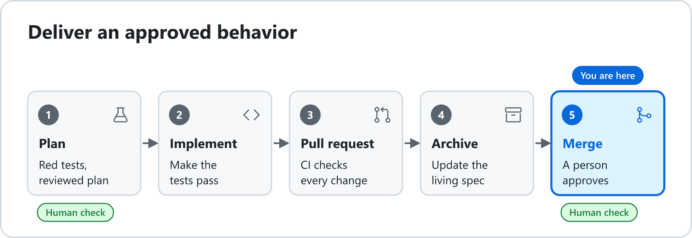
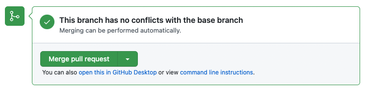

## Step 5: Merge after CI passes

Mona saw the living spec, @{{ login }}. :package: One gate is left, and it belongs to a person: who decides that this change ships?

### 📖 Theory: The last gate is a person

Merging a pull request puts its changes on `main`, the branch everyone builds from. On a real team, [protected branch rules](https://docs.github.com/en/repositories/configuring-branches-and-merges-in-your-repository/managing-protected-branches/about-protected-branches) can require passing status checks and an [approving review](https://docs.github.com/en/pull-requests/collaborating-with-pull-requests/reviewing-changes-in-pull-requests/about-pull-request-reviews) from someone other than the author before anyone can merge. CI shows that the checks pass; a reviewer decides whether the change is the right one. In this exercise you work alone, so you merge your own pull request to close the loop. That is **not** independent approval: on a real team, another person reviews and approves the change first.

### ⌨️ Activity: Review and merge the pull request

1. In your browser, open your pull request from `implement-dependent-privacy`. Your archive commit started the **CI / Tests and spec validation** check again. Wait until it shows a green check mark. Mona's own checks appear in the same list.

   > ❕ **Important:** If **CI** fails, don't merge. Select **Details**, fix the first error in your codespace, then commit and push, and wait for a green check.

1. Open the **Files changed** tab and review it as the last human gate. Expect your plan, your tests, `src/claim-visibility.js`, the ticked tasks and the move of the change into the living spec and the archive. Nothing in `features/` should appear.

1. Ask yourself the question a reviewer would ask: what does this pull request still not prove? Your description already answers it. Update it if the archive changed your answer.

1. On the **Conversation** tab, select **Merge pull request**, then **Confirm merge**.

   

1. Go back to the exercise issue. Wait a moment for Mona to check your work, provide feedback, and share the next lesson.

Having trouble? 🤷
 

- **The merge box says some checks haven't completed yet, or were not successful:** Wait for CI, or fix the failure and push. Don't merge until CI is green.

- **You closed the pull request without merging:** Select **Reopen pull request**, wait for CI, then merge. Mona continues only after a merge.

- **Mona did not respond:** Check that the pull request was merged into `main`, not just closed. You can watch the run in the [Actions tab](https://github.com/{{ full_repo_name }}/actions).

