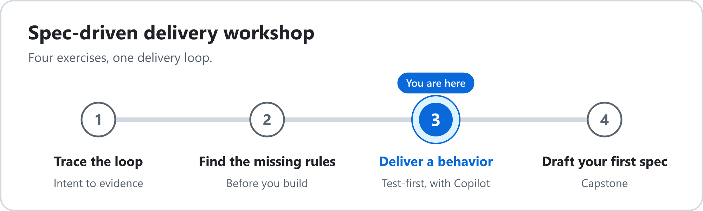

## Review

_Congratulations, you've completed this exercise and learned how to deliver an approved change with Copilot, with a person at every gate and evidence for every scenario!_

Here's a recap of what you accomplished:

- You reviewed a delivery plan that Copilot drafted against the approved spec, and recorded the human decision.
- You added tests named with scenario IDs and saw them fail against the stub before any code existed.
- You let Copilot implement the rule until the unit tests and the Gherkin feature passed, and checked that it changed only the code.
- You opened a pull request that traced every scenario ID to evidence, said what the evidence does not prove, and passed CI.
- You archived the change, so `openspec/specs/member-claim-privacy/spec.md` now holds the rules, and merged after CI passed.

### Check your understanding

Try to answer from memory before you peek. Recalling is what makes it stick.

Why must new tests fail against the stub before any code is written?
 

A test that fails first shows that it really calls the code it claims to test. A test that already passes against a stub that throws never reaches the rule, so its later green result proves nothing.

Copilot says a test is wrong and offers to change it so that it passes. What should you do?
 

Stop and compare the test with the scenario in the approved spec. If the test is wrong, fix it in a separate, reviewed change. If the spec is unclear, ask the people who own it. Never change a test, a feature or a spec just to get a pass: that moves the target.

What does archiving a change do, and why does it matter?
 

It merges the change's requirements into the living spec under `openspec/specs/` and moves the change folder to a dated folder under `openspec/changes/archive/`. The living spec then describes how the system behaves today, so the next change starts from the truth.

You merged your own pull request after CI passed. Was the change approved?
 

No. CI shows that the checks pass, and your merge closed the loop, but nobody else reviewed the change. On a real team, protected branch rules require an approving review from someone other than the author before the merge.

### Take it to your work

Pick one approved story in your team's backlog. List its scenario IDs, and for each one write the name of the failing test you would add first. Then write one sentence on what those tests would not prove.

### What's next?

- Continue the workshop with exercise 4, **Draft Your First Spec**, where you turn an unfamiliar business problem into a validated OpenSpec change of your own and decide whether it is ready to build.
- Read about [Agent mode in VS Code](https://code.visualstudio.com/docs/copilot/chat/chat-agent-mode) and how to [add repository custom instructions](https://docs.github.com/en/copilot/how-tos/configure-custom-instructions/add-repository-instructions) for Copilot.
- Explore more [GitHub Skills exercises](https://learn.github.com/skills).
