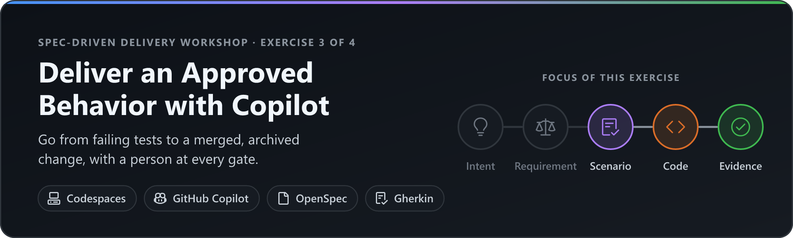
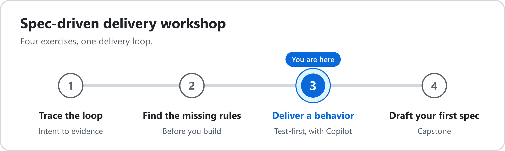

# Deliver an Approved Behavior with Copilot

_Go from an approved change to failing tests, working code, a pull request with evidence and an updated living spec, with Copilot doing most of the coding and a person at every gate._

## Welcome

- **Who is this for**: Product owners, business analysts, testers, developers and architects who can read an OpenSpec change and a Gherkin feature.
- **What you'll learn**: How to keep Copilot inside an approved scope with a reviewed plan, tests that fail first, continuous integration (CI), an archived change and a human merge.
- **What you'll build**: A working dependent claim privacy rule, delivered through a pull request and archived into the living spec.
- **Prerequisites**:
  - Exercises 1 and 2 of this workshop are recommended. You should be comfortable with branches, commits and pull requests. If they are new to you, start with [Introduction to GitHub](https://github.com/skills/introduction-to-github).
  - Access to [GitHub Codespaces](https://docs.github.com/en/codespaces/overview). Personal accounts include monthly free usage.
  - [GitHub Copilot](https://github.com/features/copilot) with Copilot Chat in Agent mode. Copilot Free is enough.
- **How long**: This exercise takes less than 80 minutes to complete.

In this exercise, you will:

1. Review a delivery plan that Copilot drafts, and add tests that fail against the unfinished code.
1. Let Copilot implement the rule until the tests pass, without changing tests, specs or features.
1. Open a pull request that links scenario IDs to evidence, and pass CI.
1. Archive the change so the living spec holds the new rules.
1. Merge the pull request after CI passes.

This is exercise 3 of 4 in the **Spec-Driven Delivery with OpenSpec, Gherkin and GitHub Copilot** workshop. All organizations, people and data in it are fictional.

### How to start this exercise

Simply copy the exercise to your account, then give your favorite Octocat (Mona) **about 20 seconds** to prepare the first lesson, then **refresh the page**.

Having trouble? 🤷
 

When copying the exercise, we recommend the following settings:

- For owner, choose your personal account or an organization to host the repository.

- We recommend creating a public repository, since private repositories will use Actions minutes.

If the exercise isn't ready in 20 seconds, please check the [Actions](../../actions) tab.

- Check to see if a job is running. Sometimes it simply takes a bit longer.

- If the page shows a failed job, please submit an issue. Nice, you found a bug! 🐛

---

&copy; 2026 acworkma &bull; [Code of Conduct](https://www.contributor-covenant.org/version/2/1/code_of_conduct/code_of_conduct.md) &bull; [MIT License](https://gh.io/mit)
